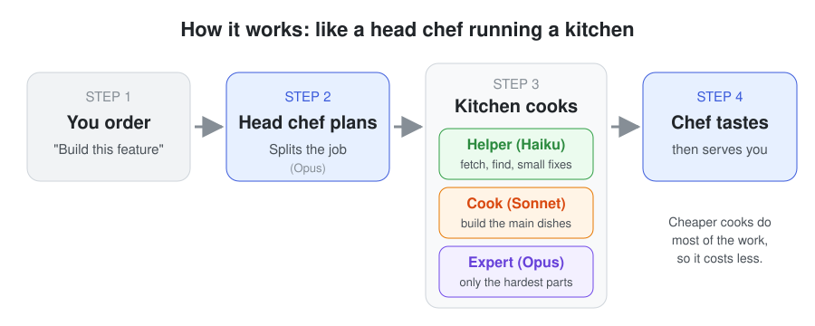
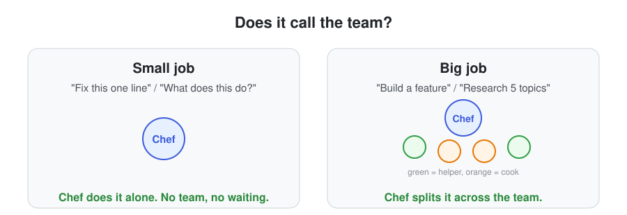
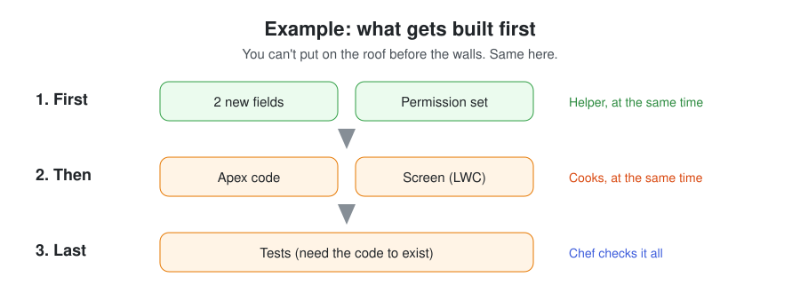
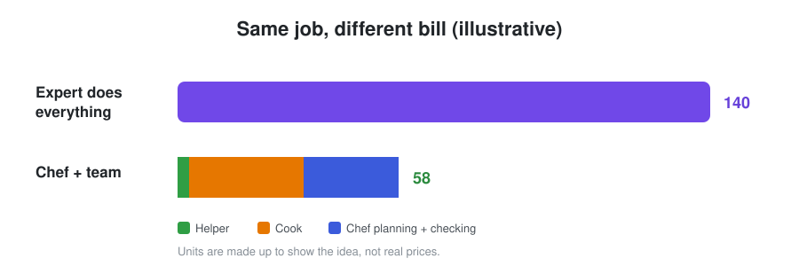
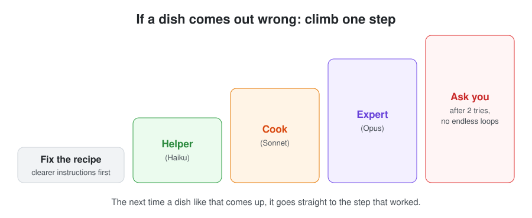

# Model Orchestrator

A Claude skill that turns Claude into a **project lead**. Instead of doing every part of a big task with the most expensive model, it breaks the task into pieces, hands each piece to the cheapest model that can do it well, checks the work, and only steps in itself when something actually needs top-level thinking.

Think of it like a senior architect running a small team: the architect plans and reviews, juniors handle the routine work, mid-level developers build the features, and the architect only writes code personally when nobody else can.

---

## Why this exists

Claude's usage limits (hourly, weekly, monthly) are **weighted by model**. The same amount of work costs more of your quota on Opus than on Sonnet, and more on Sonnet than on Haiku.

Most real tasks are a mix of easy and hard parts. Building a feature might involve:

- finding the right files (easy)
- changing a few labels (easy)
- writing several classes (medium)
- designing how the pieces fit together (hard)

If one top-tier model does all of it, you pay top-tier prices for the easy parts too. This skill makes sure each part is done by the cheapest model that can do it well, so your limits last longer without the quality dropping.

---

## How it works, at a glance



### The team

| Role | Model | What it handles | Example |
|---|---|---|---|
| **Boss** | Opus (or Fable, if your chat runs on it) | Plans, routes, reviews, decides | "This needs 3 fields, 2 classes and a component. Fields first." |
| **Junior** | Haiku | Searching, lookups, one-line edits, formatting | "Find every class that references `Account.Region__c`." |
| **Developer** | Sonnet | Writing classes and components, standard features, tests, focused research | "Write the service class and its test class." |
| **Senior** | Opus | Architecture, tricky logic, hard bugs | "Design how the integration retries failed calls." |
| **Principal** | Fable | The hardest reasoning, only if you have access | Used only when it's the session model or you say it's available |

The model names in the examples are guides, not hard rules. The boss uses its own judgment about what each model can actually handle.

---

## When it does NOT kick in

Spinning up a helper isn't free. Each one starts with no memory of the conversation, so the boss has to write it a brief, and the helper has to read files the boss may already have read.



So for a **single-pass task** (one file, one step, a quick answer), the boss just does it. No agents.

| Task | What happens |
|---|---|
| "Rename this variable in `OrderService.cls`" | Boss does it directly |
| "What does this trigger do?" | Boss answers directly |
| "Build the order-approval feature: 4 fields, a handler class, a flow, a component, and tests" | Orchestrated |
| "Research 5 vendors and compare pricing, features and support" | Orchestrated |

---

## A full example

**You say:**
> Orchestrate this: add a Discount Approval feature. We need two new fields on Opportunity, an Apex handler that checks the discount, a test class, an LWC that shows approval status, and update the permission set.

### Step 1: The boss plans

The boss notices that some pieces depend on others. The Apex code can't be written correctly until the fields exist, the component needs the Apex, and the tests need both.



### Step 2: Work runs in waves

Independent pieces run at the same time. Dependent pieces wait for what they need.

Helpers can't talk to each other directly. When a helper finishes, it reports to the boss, and the boss starts whatever was waiting on it.

### Step 3: Each helper reports back properly

No helper is allowed to just say "done". Every report follows the same format, so problems can't hide:

```
Done: Created DiscountApprovalHandler with checkDiscount() and bulk-safe query
Files: force-app/main/default/classes/DiscountApprovalHandler.cls
Assumptions: Discount above 20% needs manager approval
Issues: Threshold is hard-coded; should it come from custom metadata?
```

The boss sees the open question straight away and can ask you, or ask the helper for more detail. The helper still remembers its own work, so a follow-up is cheap.

### Step 4: The boss reviews

- **Logic-heavy work** (the Apex handler) gets a full read. Reading code is much cheaper than writing it, so this is where the boss spends its effort.
- **Trivial work** (adding a field) is checked from the summary.

### Step 5: Deploy and report

The work is validated (tests run, validate-only deploy), deployed to the sandbox automatically, and then you get a short report. A **production** deploy would stop and ask you first.

---

## Where the savings come from

The numbers below are **illustrative**, not real quota figures. They show the shape of the trade-off, using Opus = 10 units, Sonnet = 3 units, Haiku = 1 unit for the same amount of work.

| Piece of work | All on Opus | Orchestrated |
|---|---|---|
| 2 fields + permission set | 30 (Opus) | 3 (Haiku) |
| Apex handler | 40 (Opus) | 12 (Sonnet) |
| Test class + LWC | 60 (Opus) | 18 (Sonnet) |
| Planning, briefs, review | 10 (Opus) | 25 (Opus) |
| **Total** | **140** | **58** |



Note that the boss's own cost **goes up** (10 → 25). Planning, writing briefs and reviewing all cost something. The savings come from moving the heavy writing to cheaper models.

### Why reviewing is cheaper than writing

Models charge more for what they **write** than for what they **read**. When the boss reads a finished class to review it, that's the cheap side. If the boss had written the class itself, that would be the expensive side. So "Sonnet writes, Opus reads" beats "Opus writes" almost every time.

### When it does NOT save anything

- **Tiny tasks.** The overhead of briefing helpers outweighs the savings. That's why single-pass work skips orchestration.
- **Tasks that are hard all the way through.** If every piece needs Opus, splitting just adds overhead.
- **Lots of back-and-forth with helpers.** Every follow-up adds to the boss's context. Keep questions to the ones that matter.

---

## Time

Parallel waves usually finish faster than doing everything one after another, but not always:

- **Faster** when there are many independent pieces (several components, several research topics).
- **About the same** when the work is mostly a chain (each step needs the previous one).
- **Slower** on small tasks, which is another reason small tasks skip orchestration.

To protect your hourly limit from sudden bursts, the skill caps itself:

| Cap | Limit | Why |
|---|---|---|
| Helpers running at once | **5** | Past this, the boss's reviewing becomes the bottleneck and quota drains in spikes |
| Helpers per task | **15** | If a task needs more, the boss stops and checks with you |

---

## What happens when something fails

A piece of work counts as failed when the boss rejects it in review, or when the result doesn't match what you asked for. A helper that keeps needing clarification also counts as under-powered.



Two things make this efficient:

1. **It checks the brief first.** Often the model wasn't too weak; the instructions were unclear. Fixing the brief is cheaper than upgrading the model.
2. **It learns within the session.** If Haiku fails at a type of task and Sonnet succeeds, the next task of that type goes straight to Sonnet. No repeated failures.

The boss only takes over the **one piece** that failed, never the whole task. And after two failures at the top, it stops and asks you instead of looping and burning quota.

---

## Safety

| Action | What happens |
|---|---|
| Sandbox or dev deploy, other reversible changes | Runs automatically after review |
| Production deploy, publishing, sending messages, anything irreversible | Waits for your explicit yes |
| Two helpers wanting the same file | Never at the same time: one owner, or one after another |

---

## Conventions and consistency

When many helpers write code, styles can drift. The boss keeps everything consistent, using this priority order:

1. **What you say in chat** always wins.
2. **A conventions file in your project**, if one exists (naming, patterns, error handling).
3. **Best practice**, if neither of the above covers it.

Conventions aren't copied into every brief, since that would make briefs long and expensive. Helpers are pointed to the source instead.

---

## Salesforce mode

When the task involves Salesforce, extra rules apply:

- **Build order:** objects and fields → Apex and flows → LWC → tests → permissions.
- **One deploy at a time:** an org only accepts one deployment at a time, so deploys are batched into a single step and never fired from parallel helpers.
- **Validate before deploying:** tests and a validate-only deploy run first. Failed tests count as a failed piece.
- **Apex quality checks:** reviewed for bulk-safety and governor limits. Haiku never writes Apex classes.
- **Org access check:** before relying on a Salesforce connection, the boss confirms the helpers can actually reach the org.

For anything else (research, documents, other code) these rules are skipped.

---

## Install

1. Download [`model-orchestrator/SKILL.md`](model-orchestrator/SKILL.md).
2. Upload it to Claude as a custom skill.
3. Start a chat on **Opus** (or **Fable**, if you have access).

## Usage

Either call it by name:

```
/model-orchestrator Build the order-approval feature with fields, Apex, LWC and tests
```

or just say "orchestrate this" with a big task. Claude also picks it up on its own when a request is clearly multi-part.

At the end you get a short report: what was done, what was deployed or changed, any open issues, and which kinds of tasks needed a stronger model.

---

## Limits to know about

- **Session only.** Helpers and the "this task type needs Sonnet" learning last only for the current chat.
- **No direct helper-to-helper messages.** Everything goes through the boss.
- **Model only, not effort level.** The skill picks Haiku, Sonnet or Opus, but can't set a reasoning-effort level per helper.
- **Savings depend on the task.** Big, splittable tasks save the most. Small or uniformly hard tasks save little or nothing.
